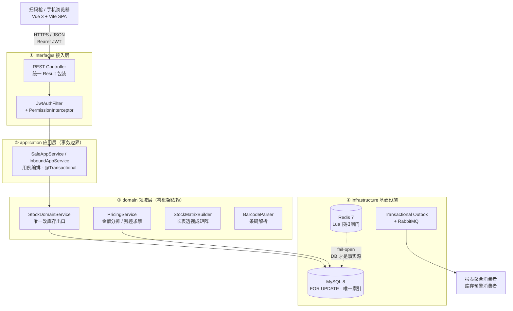
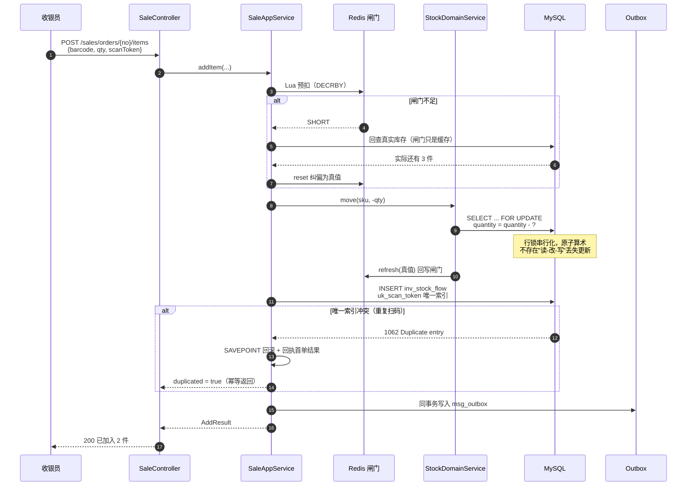

<div align="center">

# 衣恋女装 · 扫码出入库系统（Java 版）

**扫一下，就知道货在哪；两个人同时扫，账也不会错。**

面向云南临沧「衣恋时尚女装」（2 家门店 / 3–5 人 / 500–2000 件库存）的轻量进销存系统。
正面解决三个真实痛点：**并发扫码互相覆盖导致超卖**、**纸质账本月底对不上**、**断网就无法开单**。


</div>

---

## 一、项目简介

小店卖女装，SKU 维度是「款号 × 颜色 × 尺码」，一件衣服一个身份，库存单位是「件」而非「箱」。
老板的真实工作流只有三个动作：**进货扫码入库**、**卖货扫码出库**、**月底看报表对账**。
市面上的 ERP 要么按月收费且功能过剩，要么定制开发报价五位数——于是这套系统就为这 500–2000 件货、3–5 个人量身做成：

| 真实痛点 | 小店原状 | 本系统做法 |
|---|---|---|
| **两人同时扫码，账丢了** | 老板娘和店员同时开单，后写的手工记录覆盖先写的，月底盘亏才发现 | 行锁 + 原子算术 + 幂等令牌三重防御，**24 线程并发扫码零丢失**（有测试断言） |
| **纸质账本易错** | 手写小票、Excel 汇总，金额与件数反复对不上 | 金额全程 `DECIMAL` + **整数分域残差求解**，出库流水合计 = 实收金额（精确到分，有测试断言） |
| **断网没法干活** | 门店 WiFi 抖动，收银台只能停机等网 | 本地队列 + `deviceSeq` 单调序号，联网后**逐条裁决**（ACCEPTED / DUPLICATED / CONFLICTED / REJECTED），绝不整批回滚 |
| 查货靠记忆 | 「那件深蓝 L 还有吗」要翻箱子 | 输入款号 **几十毫秒内**出颜色 × 尺码矩阵视图（阈值 3 s，余量两个数量级） |
| 店员不该看进价 | 成本、毛利属于老板的底牌 | **字段级权限**：不仅接口 403，查询 SQL 里根本不 `SELECT` 成本列 |

> 业务真源：`衣恋-76 题需求答卷`（166 行 / 76 个问题），逐条落地映射见 [`docs/Requirement_Trace_Matrix.md`](docs/Requirement_Trace_Matrix.md)。

---

## 二、技术栈

| 层次 | 选型 | 版本 | 用途 |
|---|---|---|---|
| 语言 / 运行时 | Java | 21 (LTS) | 虚拟线程可用、`record` / 文本块 / 模式匹配 |
| 框架 | Spring Boot | 3.3.5 | Web、事务、Actuator、Validation |
| 架构 | DDD 四层 | interfaces / application / domain / infrastructure | 依赖只向内，domain 无框架注解 |
| 持久化 | MySQL + Spring JDBC（`JdbcTemplate` 手写 SQL）+ Flyway | 8.0.36 | 28 张业务表，行锁与唯一索引承担并发正确性 |
| 缓存 | Redis（Lettuce）+ Lua + Caffeine | 7.2 | 库存预扣闸门、矩阵视图代际缓存、限流、元数据本地缓存 |
| 消息 | RabbitMQ（Spring AMQP） | 3.13 | 事务性发件箱 → 报表聚合 / 库存预警 |
| 鉴权 | JWT + 自定义 `@RequirePermission` + 拦截器 | — | RBAC，15 项权限码，按角色裁剪 |
| 文档 | SpringDoc OpenAPI | 2.x | `/openapi.json` + `/doc` 在线调试 |
| 前端 | Vue 3 + Vite + vue-router | 3.5 / 6 | SPA，独立工程、独立镜像、无 UI 框架依赖 |
| 部署 | Docker Compose | 2.x | MySQL + Redis + RabbitMQ + API + Nginx 五件套一键拉起 |

---

## 三、核心架构



**依赖方向严格单向**：`interfaces → application → domain ← infrastructure`。
`domain` 包里没有一行 Spring 注解，也不 import `jakarta.*`——它只定义端口（`domain/port`）与仓储接口（`domain/repository`），由 `infrastructure` 反向实现。这样领域逻辑可以脱离容器跑单测（27 项测试里 19 项是纯领域测试）。

### 一次扫码出库，系统里发生了什么



---

## 四、核心亮点

### 1. 三层防御，把「两人同时扫」变成一道可证明的等式

| 防线 | 机制 | 防住什么 |
|---|---|---|
| ① 数据库 | `SELECT ... FOR UPDATE` 行锁 + `quantity = quantity - ?` 原子算术 | 丢失更新（lost update）、超卖 |
| ② 业务 | `inv_stock_flow.uk_scan_token` 唯一索引 + `inv_scan_token` 回执表 | 同一次扫码被重复扣减（网络重试、双击） |
| ③ 缓存 | Redis Lua 预扣闸门，`fail-open` | 高并发下的无效打库；闸门失效不影响正确性 |

关键细节：幂等撞车时**必须用当前读**。`REPEATABLE READ` 下普通 `SELECT` 走事务开始快照，看不见并发事务刚提交的流水——会出现"唯一索引说重复、却查不到那一行"的 500。所以回执查询显式加 `FOR SHARE`（`findByScanTokenCurrent`）。

测试证据：`ConcurrencyIT.noLostUpdate`（24 线程同 SKU 并发 +1/-1）、`noOversell`（库存 5 / 30 线程抢购，恰好 5 成功）、`sameScanTokenUnderConcurrency`（12 线程同令牌，仅 1 条流水）。

### 2. 闸门会自我纠偏，不会「补货后仍报缺货」

预扣闸门用 `NX` 写入，**不覆盖已有值**。若只在启动时 warm-up，补货后闸门仍是旧的低水位，会误报缺货。修复两道：
- 每个改变库存的出口（入库、出库、盘点、调拨、退货、报损）都通过 `StockAvailabilityPort.refresh()` 回写闸门，领域层不认识 Redis；
- `SHORT` 分支**先回查数据库再裁决**，用真值 `reset` 覆盖陈旧闸门。

### 3. 事务性发件箱（Outbox），消息不会丢也不会早于事务

```
业务写库 ──同事务──> msg_outbox(status=0)
                        │ 定时抢占：FOR UPDATE SKIP LOCKED
                        ▼
                    RabbitMQ 投递 → status=1（成功）/ 3（失败，指数退避，5 次转死信）
                        │
                        ▼
              消费端 msg_consumed 主键幂等
```
不引入分布式事务，也不做"先发消息后写库"。交换机命名空间 `yilian.stock.java`——同机并行跑 Python 版时不会串台。

### 4. 断网也能开单：离线队列 + 逐条裁决

客户端把扫码操作写入 `localStorage` 队列，每条带 `deviceSeq`（本地单调递增，**不信任手机时钟**）。
联网后整批上传，服务端对每条独立裁决：

| 裁决 | 含义 | 客户端动作 |
|---|---|---|
| `ACCEPTED` | 首次处理，已生效 | 出队 |
| `DUPLICATED` | 服务端已有同 `scanToken`，返回首次结果快照 | 出队（不重复计数） |
| `CONFLICTED` | 库存不足等业务冲突 | 出队 + 提示人工处理 |
| `REJECTED` | 参数非法 | 出队 + 记录 |

**绝不整批回滚**：一条坏数据不该让另外 20 条正确记录一起丢。每条用 `SAVEPOINT` 隔离，整批仍是一个事务提交。

### 5. 字段级权限：不是"返回 0"，是"根本没查"

| 层级 | 做法 |
|---|---|
| 接口级 | 无权限直接 403（不是返回 0，避免"看起来有数据但都是零"的误导） |
| DTO 级 | `@JsonInclude(NON_NULL)` 装配时留空，店员视角下 `purchasePrice` / `grossProfit` 字段直接消失 |
| SQL 级 | 店员身份的查询里写 `NULL AS purchase_price`，**成本列不发生数据搬运** |

测试证据：`PermissionIT.clerkCannotSeePurchasePrice`（断言 `isNull() || isMissingNode()`）、`clerkForbiddenOnProfitReport`（403）、`permissionCodesDifferByRole`（店主 15 项 / 店员 9 项）。

### 6. 金额精确到分：整数分域残差求解

明细表只存单价（两位小数），行金额现算。多件行会出现「单价 × 件数」回算差 1 分的问题。
解法分两步：
1. **行级精确**：折扣按比例分摊后，最后一行吃掉全部舍入差额；
2. **整数分域求解**：要在不改总额的前提下微调各行单价，等价于求 `Σ uᵢ·qᵢ = 实收`（调 1 分单价，行金额变动 `qᵢ` 分）。可达集合是 `{Σ kᵢqᵢ}`，由 `gcd(qᵢ) | r` 判定有解；**无解时把残差暴露出来**（`residualCents[0] ≠ 0`），而不是偷偷抹平。

不变式：`flow_type IN (2,7,8)` 的流水金额求和 **必须等于** 实收金额。`PricingServiceTest` 用 7 行含 `qty=2/3` 的刁钻组合断言精确相等。

### 7. 矩阵视图：SQL 只取长表，透视在应用层

行 = 款号 + 尺码（`sizeOrder()` 业务序：XS→S→M→L→XL→XXL，**不依赖 SQL ORDER BY**，字典序会把 `L` 排到 `M` 前面），列 = 颜色（按总库存降序），格子只存非零值。
缓存用**代际号**（`stock:gen` INCR）而非逐 key 失效——库存一变代际 +1，旧缓存自然不可达，不用扫 key。

实测（compose 栈、含网络与 JWT 校验）：8 色 × 20 行、129 件在库，连续 5 次请求 **80.5 / 49.7 / 41.8 / 16.1 / 37.8 ms**，全部远低于 3 s 阈值。

---

## 五、快速启动

### 方式 A：Docker Compose 一键拉起（推荐）

```bash
git clone https://gitee.com/ma-lichen/cothing_java.git
cd cothing_java

docker compose up -d --build      # 首次构建约 3–5 分钟
docker compose ps                 # 五个服务全部 healthy 即可用
```

打开 **<http://localhost:8081>**，用演示账号登录：

| 角色 | 手机号 | 密码 | 可见范围 |
|---|---|---|---|
| 店主 | `13800000000` | `123456` | 全部 15 项权限（含进价、毛利、报表） |
| 店员 | `13900000001` | `123456` | 9 项权限（无成本、无利润报表） |

| 服务 | 地址 | 说明 |
|---|---|---|
| 前端 | <http://localhost:8081> | Nginx 反代 `/api` 到后端，同源无跨域 |
| 后端 API | <http://localhost:18081> | 健康检查 `/actuator/health` |
| 接口文档 | <http://localhost:18081/doc> | Swagger UI，请求体带示例可直接 Try it out |
| OpenAPI | <http://localhost:18081/openapi.json> | 48 条 path |
| RabbitMQ 控制台 | <http://localhost:25672> | `yilian` / `yilian123` |
| MySQL | `localhost:13306` | `root` / `root123`，库 `yilian_clothing` |
| Redis | `localhost:16379` | 无密码 |

> 端口刻意避开 `3306 / 6379 / 5672`：本机若已装 MySQL，用默认端口会直接 `port is already allocated`，
> 对不熟 Docker 的人极不友好。需要改端口就设置环境变量，如 `API_PORT=9090 docker compose up -d`。
> 数据卷 `mysql-data` 保留数据；`docker compose down -v` 会连数据一起清掉（下次启动重新灌演示数据）。

### 方式 B：本地开发

```bash
# 1) 起中间件（只起依赖，不起应用）
docker compose up -d mysql redis rabbitmq

# 2) 后端
cd backend
DB_URL='jdbc:mysql://127.0.0.1:13306/yilian_clothing?serverTimezone=Asia/Shanghai' \
DB_PASSWORD=root123 REDIS_HOST=127.0.0.1 REDIS_PORT=16379 \
MQ_HOST=127.0.0.1 MQ_PORT=15673 MQ_USER=yilian MQ_PASSWORD=yilian123 \
SERVER_PORT=8080 mvn spring-boot:run

# 3) 前端（另开终端）
cd frontend
npm install
VITE_PROXY=http://127.0.0.1:8080 npm run dev     # http://localhost:5173
```

---

## 六、目录结构

```text
clothing/
├── backend/
│   ├── pom.xml                          Spring Boot 3.3.5 / Java 21
│   └── src/main/
│       ├── java/com/yilian/clothing/
│       │   ├── interfaces/              ① 接入层：Controller、DTO、异常处理器
│       │   │   ├── controller/          Auth / Catalog / Stock / Inbound / Sale
│       │   │   │                        Ledger / Stocktake / Report / Sync / Meta / Aux
│       │   │   └── dto/                 请求响应模型（带 @Schema 示例）
│       │   ├── application/             ② 应用层：用例编排 + 事务边界
│       │   │   ├── service/             SaleAppService、InboundAppService、SyncAppService…
│       │   │   └── job/                 定时任务（outbox 补偿、预警扫描）
│       │   ├── domain/                  ③ 领域层：纯 Java，零框架依赖
│       │   │   ├── model/               实体、值对象、枚举、报表视图
│       │   │   ├── service/             StockDomainService（唯一改库存出口）
│       │   │   │                        PricingService / StockMatrixBuilder / BarcodeParser
│       │   │   ├── port/                StockAvailabilityPort（闸门回写端口）
│       │   │   └── repository/          仓储接口（由 infrastructure 实现）
│       │   ├── infrastructure/          ④ 基础设施
│       │   │   ├── persistence/         JDBC 实现、行锁 SQL、FOR SHARE 当前读
│       │   │   ├── cache/               StockGate（Lua 预扣）、StockCache、RateLimiter
│       │   │   ├── mq/                  Outbox、RabbitConfig、两个消费者、PayloadReader
│       │   │   ├── security/            JWT、拦截器、@RequirePermission
│       │   │   ├── demo/                演示数据灌入（6 款 33 个 SKU）
│       │   │   └── config/              MyBatis/JDBC、OpenAPI、Web 配置
│       │   └── common/                  统一返回体、异常、工具
│       └── resources/
│           ├── application.yml
│           └── db/migration/            Flyway：V1 建表 28 张 + V2 种子数据
├── frontend/                            Vue 3 + Vite 独立前端工程
│   ├── src/
│   │   ├── views/                       Login / Sale / Stock / Inbound / Report / Ledger
│   │   ├── api.js                       fetch 封装 + 业务错误 + 401 跳转
│   │   ├── offline.js                   localStorage 队列 + deviceSeq + flush()
│   │   ├── router.js                    hash 路由 + 登录守卫
│   │   └── styles.css                   米白纸感 / 墨色 / 朱红
│   ├── nginx.conf                       反代 /api，导出接口关闭 proxy_buffering
│   └── Dockerfile                       Node 构建 → Nginx 运行
├── docker-compose.yml                   五服务编排（含 healthcheck 与启动顺序）
└── docs/                                决策记录、需求追踪、验收清单、深度讲义
```

---

## 七、主要接口

| 模块 | 方法与路径 | 说明 |
|---|---|---|
| 认证 | `POST /api/v1/auth/login` | 手机号 + 密码 → JWT（PBKDF2-SHA256 校验） |
| 扫码 | `GET /api/v1/catalog/barcode/{code}` | 解析条码 → SKU + 当前库存 |
| 库存 | `GET /api/v1/stock/matrix?warehouseId=` | 颜色 × 尺码矩阵视图 |
| 库存 | `GET /api/v1/stock/alerts?warehouseId=` | 低于安全库存的清单 |
| 入库 | `POST /api/v1/inbound/orders/{no}/items` | 扫码加行（含幂等） |
| 入库 | `POST /api/v1/inbound/orders/{no}/submit` | 提交入库 → 库存 +N |
| 销售 | `POST /api/v1/sales/orders/{no}/items` | 扫码出库（三层防御核心入口） |
| 销售 | `POST /api/v1/sales/orders/{no}/checkout` | 结账（折扣分摊 + 实收校验） |
| 离线 | `POST /api/v1/sync/batch` | 离线队列整批上传，逐条裁决 |
| 报表 | `GET /api/v1/reports/overview` | 今日/本周/本月经营概览 |
| 报表 | `GET /api/v1/reports/profit` | 毛利（店员访问 → 403） |
| 导出 | `GET /api/v1/reports/export` | 真实 xlsx（非 CSV 伪装的 .xlsx） |

响应统一包装：`{ "code": 0, "message": "ok", "data": {...} }`；业务异常也走 HTTP 200 + 非零 `code`，只有鉴权失败才用 401/403。

---

## 八、测试与验收

```bash
# 全部测试（领域单测 + 集成测试 + 并发测试）
cd backend && mvn -o test

# 需要可用的 MySQL / Redis / RabbitMQ：
# 用 compose 起依赖，或按 IntegrationTestSupport 里的环境变量指向
mvn test -Dtest='ConcurrencyIT,PermissionIT'
```

最近一次实测结果：

```
Tests run: 27, Failures: 0, Errors: 0, Skipped: 0
BUILD SUCCESS   （2 分 45 秒）
```

| 测试类 | 数量 | 覆盖内容 |
|---|---|---|
| `BarcodeParserTest` | 6 | EAN-13 纯码、`\|` 六段、`#` 旧码、非法日期丢弃、段数不足降级 |
| `PricingServiceTest` | 7 | 7 行含多件的分摊精确性、无解残差暴露、纯函数性、毛利按实收算 |
| `StockMatrixBuilderTest` | 6 | 尺码业务序、未知码排最后、颜色降序、同量按名稳定、零格丢弃、跨仓求和 |
| `ConcurrencyIT` | 4 | 24 线程不丢更新、12 线程同令牌幂等、5 件库存 30 人抢不超卖、补货后闸门回写 |
| `PermissionIT` | 4 | 店员看不到进价、店员访问利润报表 403、匿名拒绝、权限码按角色裁剪（15/9） |

DoD 逐项验收（含实测数字与命令）见 [`docs/DoD_Checklist.md`](docs/DoD_Checklist.md)。

---

## 九、文档索引

| 文档 | 内容 |
|---|---|
| [`docs/Decision_Log.md`](docs/Decision_Log.md) | 14 条架构决策记录（ADR-01~14）+ 被否决方案及理由 |
| [`docs/Requirement_Trace_Matrix.md`](docs/Requirement_Trace_Matrix.md) | 76 题逐条 → 实现位置 → 测试证据（完全实现 71 / 部分 3 / 与 Q73 一致不做 2） |
| [`docs/DoD_Checklist.md`](docs/DoD_Checklist.md) | 8 项验收标准逐条实测（一键启动、扫码 +1、3 秒矩阵、并发不超卖、Swagger 示例…） |
| [`docs/Stage_Report_Java.md`](docs/Stage_Report_Java.md) | 阶段交付报告：文件清单、自检命令、执行结果、未完成项 |
| `docs/lecture/` | 12 章深度讲义源码（导出 44 页 PDF：骨架职责 → 语法逐行 → 底层机制） |

---

## 十、两版对照（同一份业务契约，两套独立实现）

本仓库是 **Java 版**，另有一个 **Python（FastAPI）版**在同一业务契约下的独立实现：
<https://gitee.com/ma-lichen/chting_python>

| 维度 | Java 版（本仓库） | Python 版 |
|---|---|---|
| Web 框架 | Spring Boot 3.3.5 | FastAPI 0.115 |
| 分层 | DDD 四层（interfaces/application/domain/infrastructure） | Routers / Services / Domain / Repositories |
| 数据访问 | JDBC + 手写行锁 SQL | SQLAlchemy 2.0 Async + asyncmy |
| 事务 | `@Transactional` + SAVEPOINT | 中间件持有事务 + `begin_nested()` |
| 建表 | Flyway 版本化迁移 | SQLAlchemy 元数据 + 导出基线快照 |
| 端口 | 8081 / 18081 | 8082 / 28000 |
| 消息交换机 | `yilian.stock.java` | `yilian.stock.py` |

两者**数据库、缓存、队列、部署完全隔离**，可同时在本机运行、互不干扰；交换机命名空间分开，避免共用 broker 时串台。
唯一共享的是 HTTP 契约与前端 UI 源码——契约一致时维护两份界面只会漂移，这不构成耦合：关掉任一端后端，另一端界面照常工作。

---

<div align="center">

**业务真源**：`衣恋-76 题需求答卷`（166 行 / 76 题）· **技术栈**：Spring Boot 3.3.5 + Java 21 + Vue 3 + MySQL 8 + Redis 7 + RabbitMQ 3.13
本项目为学习 / 参赛作品，代码可自由参考，商业使用请联系作者。

</div>
